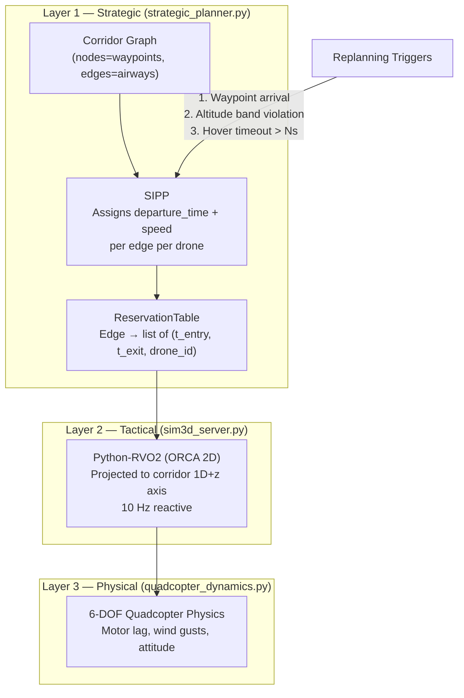

# Strategic 4D Path Planning — Agreed Design

## Architecture (3-Layer ATM Model)



---

## Layer 1 — Strategic Corridor Network

### Corridor Graph (`strategic_planner.py`)

**Structure:** Directed graph of named nodes + edges (like real ATS airways)

```python
# JSON-configurable, matched to 10-drone circular scenario in sim3d_server.py
CORRIDOR_GRAPH = {
    "nodes": {
        "HUB_NORTH":   {"x":    0, "y":    0, "z": -100},
        "GATE_NE":     {"x":  110, "y":  110, "z": -100},
        "PERIM_EAST":  {"x":    0, "y":  260, "z": -100},
        # ... one node per waypoint in the existing 4-waypoint routes
    },
    "edges": [
        # Each edge: one-way, one altitude band, one cruise speed range
        {"from": "HUB_NORTH", "to": "GATE_NE",
         "alt_m": 90.0, "alt_band_m": 10.0,
         "min_speed_ms": 8.0, "max_speed_ms": 15.0},
        # ...
    ]
}
```

**Key properties per edge:**
| Field | Description |
|-------|-------------|
| `alt_m` | Fixed nominal altitude (NED z = -alt_m) |
| `alt_band_m` | Vertical tolerance before replanning triggers (±5m) |
| `min_speed_ms` / `max_speed_ms` | Speed envelope SIPP can assign |
| One-way flow | No head-on conflicts by design |

---

## Layer 1 — SIPP Algorithm

**Goal:** Assign each drone a conflict-free `(departure_time, cruise_speed)` per edge.

**Safe Interval on an edge:**  A time window `[t_free_start, t_free_end]` during which no other drone is occupying the edge, with a safety buffer.

**Separation standard:**
```
min_separation_time = edge_length / assigned_speed + SAFETY_BUFFER_S  # (e.g. +5s)
Two drones conflict on edge E if their [t_entry, t_exit] windows overlap.
```

**Priority order (for prioritized SIPP):**
1. `EMERGENCY` — highest
2. `DELIVERY`
3. `SURVEY`
4. `PATROL` — lowest
5. Within same type: FCFS (earliest request_time first)

**Replanning triggers (any of these fires a SIPP replan from current node):**
1. **Waypoint arrival** — drone reaches a graph node → replan remaining route
2. **Altitude band violation** — `|current_z - edge_alt_z| > alt_band_m` for > 2s
3. **Hover timeout** — drone speed < 0.5 m/s for > `HOVER_TIMEOUT_S` (e.g. 8s)

---

## Layer 2 — Tactical ORCA (Modified)

**Key change from current:** Project agents onto the **1D corridor axis + z** rather than full 2D (x,y).

```
corridor_axis = unit vector from edge.from_node → edge.to_node (x,y only)
projected_pos_1d  = dot(drone_pos_xy, corridor_axis)
projected_vel_1d  = dot(drone_vel_xy, corridor_axis)
```

- RVO2 `addAgent` receives `(projected_pos_1d, drone_z)` — a 2D coordinate in (along-corridor, altitude) space
- ORCA resolves: drones that are close along the corridor and at similar altitude get velocity adjustments

This preserves Python-RVO2 while making ORCA altitude-aware.

---

## Layer 3 — Physical (Unchanged)

`quadcopter_dynamics.py` is unchanged. It receives `(vx_cmd, vy_cmd, vz_cmd)` from ORCA and applies:
- First-order motor lag (τ = 0.35s)
- Acceleration limits
- Wind gust disturbances (Ornstein-Uhlenbeck)
- Attitude dynamics

---

## File Change Summary

| File | Change |
|------|--------|
| **`strategic_planner.py`** (new) | `CorridorGraph`, `SIPPPlanner`, `ReservationTable`, `MissionPlan` classes |
| **`sim3d_server.py`** | Import `StrategicPlanner`; replace `init_scenario()` waypoints with SIPP-assigned routes; add 3 replanning trigger checks per step; pass (v_x, v_y, v_z) in corridor frame to ORCA |
| **`quadcopter_dynamics.py`** | No changes |
| **`traffic_bridge.py`** | No changes (single-ego 2D use case separate) |
| **`tactical_visualizer.py`** | No changes |
| **`web3d/index.html`** | Add corridor tube rendering (THREE.js CylinderGeometry per edge, color = altitude band); add SIPP slot labels on drones |

---

## New Classes in `strategic_planner.py`

```
CorridorNode       — x, y, z, name
CorridorEdge       — from_node, to_node, alt_m, alt_band_m, min/max_speed
CorridorGraph      — load from dict/JSON; path-finding (Dijkstra) for route selection
ReservationTable   — per-edge list of (t_entry, t_exit, drone_id, speed)
                     + conflict check + reservation + release
SIPPState          — (node_id, arrival_time, speed) for A* open set
SIPPPlanner        — priority queue search; returns MissionPlan
MissionPlan        — per-drone list of CorridorLeg(edge, depart_t, speed, alt_m)
StrategicController — top-level: owns graph + table + all plans;
                      called by sim3d_server on triggers
```

---

## Open Implementation Questions (Resolved)

| # | Question | Answer |
|---|----------|--------|
| 1 | Algorithm | SIPP on corridor graph (prioritized) |
| 2 | Corridor geometry | Directed graph of named nodes + edges |
| 3 | Graph definition | Hardcoded dict/JSON matched to scenario |
| 4 | Altitude per edge | Fixed band, one direction of flow |
| 5 | ORCA dimensionality | Project to 1D-along-corridor + z; use Python-RVO2 |
| 6 | Replanning triggers | Waypoint arrival OR altitude violation OR hover timeout |
| 7 | Code location | New `strategic_planner.py`, imported by `sim3d_server.py` |
| 8 | Visualization | 3D WebGL corridor tubes + SIPP slot labels |
| 9 | Speed model | Variable: SIPP assigns (depart_t, speed) per edge |
| 10 | Priority | Mission type (emergency > delivery > survey > patrol), FCFS within type |
| 11 | Separation standard | `edge_length/speed + 5s` time buffer on each edge |
